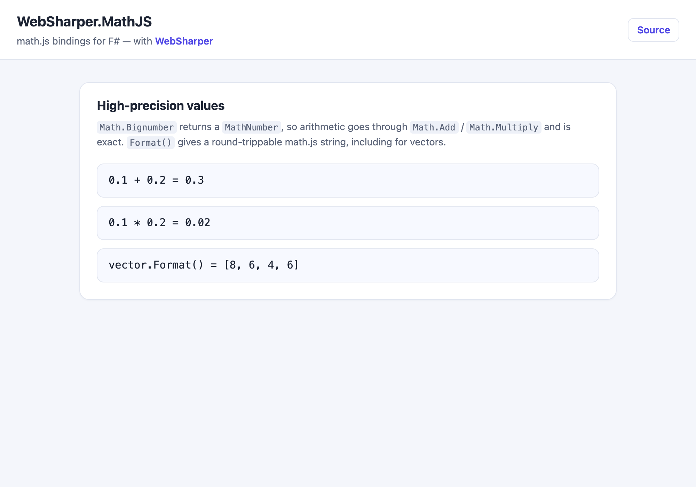

# WebSharper.MathJS

[](https://www.nuget.org/packages/WebSharper.MathJS)

WebSharper bindings for [math.js](https://mathjs.org/) for F# and C# web apps,
including high-precision numbers. Since WebSharper 7 the compiler can extend
type-driven translation via modular, ESM-based bindings, so high-precision values
(`decimal`, `bigint`, ...) can be used in RPCs and other server-client data
exchanges by adding `WebSharper.MathJS` as a dependency; otherwise the compiler
warns on usage, as expected.

This repository contains:

| Project | Purpose |
|---|---|
| `WebSharper.MathJS` | The binding: the math.js API surface. |
| `WebSharper.MathJS.Extensions` | `System.Decimal`/`System.Numerics.Complex` proxies onto math.js, and the `MathNumber.Format()` accessor. |
| `WebSharper.UI.Decimal` | WebSharper.UI helpers for `decimal`. |
| `WebSharper.MathJS.Tests.Client` / `.Server` | The test suite (QUnit). |
| `WebSharper.MathJS.Sample` | A runnable WebSharper 10 SPA demonstrating the binding. |

## Live demos

- **Binding sample (this repo):** https://dotnet-websharper.github.io/mathjs/
- **Sample in the WebSharper samples gallery:** https://websharper-samples.github.io/MathJS/
- **Sample source in the gallery:** https://github.com/websharper-samples/MathJS
- **WebSharper:** https://websharper.com



## Install

```bash
dotnet add package WebSharper.MathJS
```

Or with Paket:

```fsharp
nuget WebSharper.MathJS
```

The package targets `netstandard2.0` and works with any WebSharper 10 project.

## Usage

math.js values are represented by the `MathNumber` type. `Math.Bignumber`
returns a `MathNumber` (not a `System.Numerics.BigInteger`), so arithmetic must
go through the math.js functions:

```fsharp
open WebSharper
open WebSharper.MathJS

[<JavaScript>]
let Demo () =
    let a = Math.Bignumber "0.1"
    let b = Math.Bignumber "0.2"
    let sum = Math.Add(a, b)          // "0.3" (exact, math.js BigNumber)
    let product = Math.Multiply(a, b) // "0.02"

    // Format() (from WebSharper.MathJS.Extensions) gives the math.js string
    // form, which is round-trippable.
    Console.Log(sum.Format())
```

`Format()` matters for vectors: math.js formats them with brackets and it is
parseable by `Math.Parse`, whereas the default `ToString()` is not:

```fsharp
let v = MathNumber [| 8.; 6.; 4.; 6. |]
v.ToString() // "8,6,4,6"     -- not parseable
v.Format()   // "[8, 6, 4, 6]" -- round-trippable
```

### Notes on the API

- `Math.Bignumber`/`Math.Bigint` return `MathNumber`. Arithmetic uses
  `Math.Add`, `Math.Subtract`, `Math.Multiply`, `Math.Divide`, ... (these avoid
  the previous footgun where F#'s `+` on a `bigint`-typed value silently
  concatenated strings).
- `MathNumber.Format()` (an extension in `WebSharper.MathJS.Extensions`, in the
  same NuGet package) returns math.js's formatting; it is round-trippable for
  vectors, lists and matrices.
- The `System.Decimal` proxy maps .NET decimal arithmetic onto math.js
  BigNumbers, so `decimal` values work transparently in F# and over RPC.

## Build from source

### Prerequisites

- [.NET SDK](https://dotnet.microsoft.com/download) 8.0 or later.
- [Node.js](https://nodejs.org/) (LTS) for the esbuild bundle step.
- [Paket](https://fsprojects.github.io/Paket/) as a local dotnet tool (already
  configured in `.config/dotnet-tools.json`).

### Restore and build

```bash
dotnet tool restore
dotnet tool run paket restore
dotnet build WebSharper.MathJS.sln -c Release
```

### Run the sample

The sample is a static WebSharper 10 SPA. Building it in Release produces the
self-contained site in `dist/`:

```bash
cd WebSharper.MathJS.Sample
dotnet build -c Release
# then serve the generated site, e.g.
npx serve ../dist
```

### Pack the NuGet package

After a Release build:

```bash
dotnet tool run paket pack ./out
```

The resulting `.nupkg` contains `WebSharper.MathJS.dll` and
`WebSharper.MathJS.Extensions.dll` under `lib/netstandard2.0`, plus the binding source.

### Deployment

Pushing to `master` triggers `.github/workflows/ghpages.yml`, which builds the
sample in Release and publishes `dist/` to the `gh-pages` branch via GitHub Pages.

## Repository layout

```
WebSharper.MathJS/                # the binding
  Main.fs
WebSharper.MathJS.Extensions/     # decimal/complex proxies + MathNumber.Format
  Complex.fs
  Decimal.fs
  MathNumber.fs
WebSharper.UI.Decimal/            # WebSharper.UI helpers for decimal
WebSharper.MathJS.Sample/         # WS10 SPA sample
  Client.fs
  index.html
  esbuild.config.mjs
WebSharper.MathJS.Tests.Client/   # QUnit test suite (client)
WebSharper.MathJS.Tests.Server/   # QUnit test suite (server)
nuget/                            # Paket pack templates
.github/workflows/ghpages.yml     # build + deploy sample to gh-pages
```

## License

Apache 2.0 — see [LICENSE.md](LICENSE.md).
