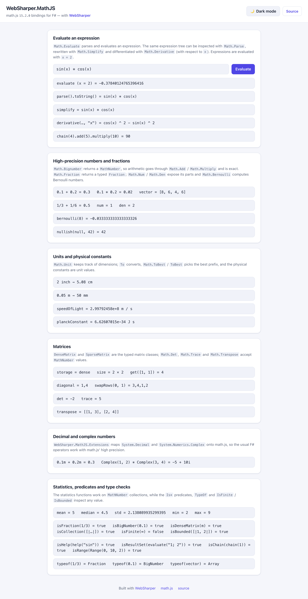

# WebSharper.MathJS

[](https://www.nuget.org/packages/WebSharper.MathJS)

WebSharper bindings for [math.js](https://mathjs.org/) for F# and C# web apps,
including high-precision numbers, fractions, complex numbers and units. Since
WebSharper 7 the compiler can extend type-driven translation via modular,
ESM-based bindings, so high-precision values (`decimal`, `bigint`, ...) can be
used in RPCs and other server-client data exchanges by adding
`WebSharper.MathJS` as a dependency; otherwise the compiler warns on usage, as
expected.

The binding targets **math.js 15.2.0** (`>= 15.2.0 < 16.0.0`) and is built for
WebSharper 11 on .NET 11.

This repository contains:

| Project | Purpose |
|---|---|
| `WebSharper.MathJS` | The binding: the math.js API surface, from `Math.Add` to the `DenseMatrix` / `Fraction` / `Range` classes. |
| `WebSharper.MathJS.Extensions` | `System.Decimal` / `System.Numerics.Complex` proxies onto math.js, and the `MathNumber.Format()` accessor. |
| `WebSharper.UI.Decimal` | WebSharper.UI helpers for `decimal`. |
| `WebSharper.MathJS.Tests.Client` / `.Server` | The test suite (QUnit). |
| `WebSharper.MathJS.Sample` | A static SPA that exercises the binding in the browser, with a light/dark theme switcher. |

## Live demos

**Try it live:** [Open the sample in your browser](https://dotnet-websharper.github.io/mathjs/)



The sample doubles as the binding's [test case](#running-the-test-case): it
evaluates expressions interactively and exercises high-precision numbers,
fractions, units and physical constants, the typed matrix classes, the decimal
and complex proxies, statistics and the type predicates.

- **Sample in the WebSharper samples gallery:** <https://websharper-samples.github.io/MathJS/>
- **Sample source in the gallery:** <https://github.com/websharper-samples/MathJS>
- **WebSharper:** <https://websharper.com>

## Features

- **Numbers:** `number`, `bigint`, `BigNumber` (via `Math.Bignumber`, returned as
  `MathNumber`), `Fraction` (a typed `Fraction` class with `Num` / `Den` /
  `Bernoulli`) and `Complex`.
- **Arithmetic:** the full function set — `add`, `subtract`, `multiply`,
  `divide`, the `dot*` variants, the low-level `*Scalar` helpers, `gcd`, `lcm`,
  `mod`, `pow`, the trigonometry family, `bernoulli` and the combinatorics
  functions.
- **Units:** `Math.Unit` / `Math.CreateUnit`, conversions with `To` and
  `Math.ToBest` / `ToBest`, and every physical constant (`Math.SpeedOfLight`,
  `Math.PlanckConstant`, ...) as a `Unit` value.
- **Matrices:** the `Matrix` interface with the `DenseMatrix` and `SparseMatrix`
  implementations, plus the matrix functions (`det`, `inv`, `pinv`,
  `transpose`, `lup`, `qr`, `schur`, `eigs`, `fft`, ...).
- **Expressions:** `Math.Parse` / `Math.Evaluate` / `Math.Compile`,
  `Math.Simplify` and `Math.Derivative` on the typed node classes
  (`ConstantNode`, `SymbolNode`, `OperatorNode`, ...), and the `Parser` /
  `Chain` classes.
- **Statistics:** `mean`, `median`, `mode`, `std`, `variance`, `min`, `max`,
  `sum`, `prod`, `quantileSeq`, `mad` and `corr`.
- **Predicates and helpers:** the `Is*` type predicates (including
  `isBigNumber`, `isFraction`, `isDenseMatrix`, `isResultSet`), `IsFinite` /
  `IsBounded`, `Nullish`, `TypeOf`, and `Replacer` / `Reviver` for JSON.

## Installation

```bash
dotnet add package WebSharper.MathJS
```

or, from Paket:

```
nuget WebSharper.MathJS
```

The package targets `netstandard2.0` and works with any WebSharper 11 project.

## Usage

math.js values are represented by the `MathNumber` type. `Math.Bignumber`
returns a `MathNumber` (not a `System.Numerics.BigInteger`), so arithmetic must
go through the math.js functions:

```fsharp
open WebSharper
open WebSharper.MathJS

[<JavaScript>]
let Demo () =
    let a = Math.Bignumber "0.1"
    let b = Math.Bignumber "0.2"
    let sum = Math.Add(a, b)          // "0.3" (exact, math.js BigNumber)
    let product = Math.Multiply(a, b) // "0.02"

    // Format() (from WebSharper.MathJS.Extensions) gives the math.js string
    // form, which is round-trippable.
    Console.Log(sum.Format())
```

`Format()` matters for vectors: math.js formats them with brackets and it is
parseable by `Math.Parse`, whereas the default `ToString()` is not:

```fsharp
let v = MathNumber [| 8.; 6.; 4.; 6. |]
v.ToString() // "8,6,4,6"     -- not parseable
v.Format()   // "[8, 6, 4, 6]" -- round-trippable
```

Fractions are a first-class type, so their parts are typed too:

```fsharp
let f = Math.Fraction(1, 3)
let g = Math.Fraction(1, 6)
let s = Math.Add(f, g)          // Fraction
string (Math.Num s)             // "1"
string (Math.Den s)             // "2"
s.ToString()                    // "0.5"
```

Units pick their best prefix, and the physical constants are unit values:

```fsharp
Math.Unit("2 inch").To("cm").ToString()   // "5.08 cm"
Math.Unit(0.05, "m").ToBest().ToString()  // "50 mm"
Math.SpeedOfLight.ToString()              // "2.99792458e+8 m / s"
```

The typed matrix classes are usable directly, while the matrix functions take
`MathNumber` collections:

```fsharp
let m = DenseMatrix([| [| 1.; 2. |]; [| 3.; 4. |] |])
m.Storage()                 // "dense"
m.Size()                    // [| 2; 2 |]
m.Get([| 1; 1 |])           // 4

let n = MathNumber [| [| 1.; 2. |]; [| 3.; 4. |] |]
Math.Det(n)                 // -2
Math.Transpose(n).Format()  // "[[1, 3], [2, 4]]"
```

### Notes on the API

- `Math.Bignumber`/`Math.Bigint` return `MathNumber`. Arithmetic uses
  `Math.Add`, `Math.Subtract`, `Math.Multiply`, `Math.Divide`, ... (these avoid
  the previous footgun where F#'s `+` on a `bigint`-typed value silently
  concatenated strings).
- `MathNumber.Format()` (an extension in `WebSharper.MathJS.Extensions`, in the
  same NuGet package) returns math.js's formatting; it is round-trippable for
  vectors, lists and matrices.
- `Math.Fraction` returns a `Fraction` whose `N`/`D`/`S` are JS `bigint`
  values (fraction.js 5 is bigint based).
- The `System.Decimal` proxy maps .NET decimal arithmetic onto math.js
  BigNumbers, and the `System.Numerics.Complex` proxy maps complex arithmetic
  onto math.js `Complex`; both work transparently in F# and over RPC.
- `Math.Apply` is obsolete: math.js renamed it to `Math.MapSlices` in 14.2.

## Running the test case

The sample is a static SPA. Build it in Release (this also runs `npm install`
and bundles math.js from the npm package with esbuild), then serve `dist/`:

```bash
dotnet build WebSharper.MathJS.Sample/WebSharper.MathJS.Sample.fsproj -c Release
dotnet serve -d dist -p 8080
```

(Install the server once with `dotnet tool install -g dotnet-serve`.)

Open <http://localhost:8080/>. The expression box evaluates, parses, simplifies
and differentiates the input (with `x = 2`), and every other card shows the
result of a binding call. The theme toggle switches between the light (default)
and dark palettes and is persisted in `localStorage`.

## Build from source

```bash
dotnet tool restore
dotnet paket restore
dotnet build WebSharper.MathJS.sln -c Release
```

The binding and the Extensions project target `netstandard2.0`; the sample
targets `net10.0` and is bundled to `dist/` by esbuild.

## Pack

```bash
dotnet paket pack ./nuget
```

The resulting `.nupkg` contains `WebSharper.MathJS.dll` and
`WebSharper.MathJS.Extensions.dll` (with their `.websharper` sidecars and XML
docs) under `lib/netstandard2.0`, plus the binding source.

## Deployment

Pushes to `master` build the sample in Release and deploy `dist/` to GitHub
Pages via `.github/workflows/ghpages.yml`.

## Repository layout

```
WebSharper.MathJS/                # the binding
  Main.fs
WebSharper.MathJS.Extensions/     # decimal/complex proxies + MathNumber.Format
  Complex.fs
  Decimal.fs
  MathNumber.fs
WebSharper.UI.Decimal/            # WebSharper.UI helpers for decimal
WebSharper.MathJS.Sample/         # static SPA sample
  Client.fs
  index.html
  esbuild.config.mjs
WebSharper.MathJS.Tests.Client/   # QUnit test suite (client)
WebSharper.MathJS.Tests.Server/   # QUnit test suite (server)
docs/sample.png                   # screenshot used in this README
nuget/                            # Paket pack templates
.github/workflows/ghpages.yml     # build + deploy sample to gh-pages
```

## License

Apache 2.0 — see [LICENSE.md](LICENSE.md).